# Exemple commenté — paiement gouverné via MCP

> **Non normatif.** Cet exemple illustre une façon de réaliser l'architecture logique CROA pour un outil de paiement exposé via MCP. Il n'ajoute aucune exigence. En cas d'écart, la spécification prévaut. Les identifiants d'invariants, les seuils, les rôles, la répartition du déploiement et le mécanisme d'identité ci-dessous sont illustratifs.
>
> **Neutralité vis-à-vis des fournisseurs.** L'exemple est indépendant de toute technologie. Il est compatible avec une implémentation qui s'appuie sur les mécanismes de permissions et de hooks propres à un runtime d'agent (par exemple les hooks et permissions de Claude Code). Cette compatibilité ne constitue une certification d'aucun fournisseur, et les hooks eux-mêmes n'apportent aucune garantie CROA. La conformité n'exige jamais un produit particulier (voir [Vendor neutrality](../../README.md#vendor-neutrality)).

English version: [payment-via-mcp.md](payment-via-mcp.md).

## Scénario

Un agent comptable fournisseurs (`ap-agent-01`) peut appeler l'outil MCP `payment.create(amount, beneficiary_id, invoice_id)`. L'API de paiement est un système gouverné situé derrière la frontière d'exécution.

Le déploiement est **hybride** (Part IV §18.3). Le serveur MCP héberge l'Agent Surface, comme le suggère Part IV §23.5.2. `C6` tourne sur une passerelle de sortie distincte, placée devant l'API de paiement : c'est le modèle DM-4 (Part IV Chapter 22). Dans un déploiement DM-5 pur, `C6` serait au contraire embarqué dans le serveur MCP, et c'est alors le serveur MCP qui détiendrait le secret de l'API.

Le **hook préalable** du runtime de l'agent n'est qu'une **défense en profondeur**. Il arrête tôt les outils non enregistrés, mais la garantie ne vient pas de lui. La garantie, c'est `C6` associé à P4 : l'API de paiement n'accepte que le trafic venant de `C6`, et `C6` n'admet que les opérations issues d'un ECC valide et non encore rédimé.

## Invariants enregistrés (illustratifs)

| Invariant | Classe | Énoncé | Levable par une autorisation `C1` ? |
|---|---|---|---|
| `I-PAY-001` | E1 | `payment.create` NE DOIT PAS dépasser 1 000 € par paiement sans artefact d'autorisation `C1` couvrant le bénéficiaire, la facture et le montant. | Oui, émise sur approbation d'un Responsable Finance (ou supérieur) |
| `I-PAY-002` | E1 | `payment.create` NE DOIT PAS dépasser 5 000 € par paiement sans artefact d'autorisation `C1` couvrant le bénéficiaire, la facture et le montant. | Oui, émise sur approbation du CFO |
| `I-PAY-003` | E2, TP-X | Le cumul des `payment.create` par (sujet, `beneficiary_id`) sur une fenêtre glissante de 24 h NE DOIT PAS dépasser 10 000 €. | Non : un dépassement cumulé est refusé à l'étape 4 de `C2.eval`, qui ne prévoit aucune autorisation (Part II §4.4.2) |

`I-PAY-003` est déclaré TP-X parce qu'une fenêtre de 24 h couvre plusieurs sessions, et que les agrégats TP-X sont indexés par sujet (Part II §4.6.3). `C4` ajoute chaque montant permis à l'agrégat, de façon sérialisée par clé. Dans cet exemple, le montant est retiré de l'agrégat si l'ECC est bloqué, expire, ou si l'exécution échoue.

**Réversibilité.** Un virement est traité comme **R2** (irréversible, faible impact) sur tous les chemins. Chaque ECC porte donc `ecc.reversibility_class = R2` et `ecc.compensating_controls`. Dans cet exemple, le contrôle R2 est l'approbation humaine préalable de la facture dans l'ERP. `C3` la vérifie à l'ancrage : la facture est approuvée et non payée, son bénéficiaire correspond, et le montant ne dépasse pas le solde restant. Une Governed Exception n'est **pas** inscrite dans `compensating_controls` : elle est liée par `ecc.auth_ref` et `ecc.exception_scope`.

## Les quatre chemins

| Demande | Résultat de `C2.eval` | Autorisation | Résultat |
|---|---|---|---|
| 350 € | `PERMIT` | aucune | ECC compilé et admis |
| 3 500 € | `DENY` (`I-PAY-001`), puis `PERMIT_WITH_AUTHORIZATION` | Demandée via l'ITSM ; le Responsable Finance approuve ; `C1` émet un `auth_id` qui lève `I-PAY-001` | ECC avec `auth_ref` et `exception_scope` ; `ecc.id` et `auth_ref` rédimés dans un même CAS |
| 7 500 € | `DENY` (`I-PAY-001`, `I-PAY-002`), puis `PERMIT_WITH_AUTHORIZATION` | Idem, avec approbation du CFO et levée des deux invariants | Idem |
| Outil non enregistré | aucun | aucune | Bloqué par le hook. Si le hook est contourné : `ADMISSION_REJECTED` (`UNAUTHORIZED_ACTION_CLASS`) à l'Agent Surface |

## Lien entre le sujet et la frontière

C'est le serveur MCP qui présente l'opération à `C6`, mais le sujet de l'ECC est l'agent. Dans cet exemple, le lien se fait ainsi :

1. L'agent s'authentifie auprès de l'Agent Surface avec une identité de charge de travail (par exemple un SVID SPIFFE). Cette identité devient `ecc.subject`.
2. Pour présenter l'opération, le serveur MCP fait un échange de jeton OAuth 2.0 (RFC 8693). Il obtient un jeton de courte durée avec `sub = ap-agent-01`, `act = mcp-payment-server` et l'audience `C6`, lié à l'`ecc.id`.
3. `C6` vérifie que `sub` est égal à `ecc.subject` et que `act` est un présentateur enregistré pour cet outil. Un ECC présenté sous un autre sujet est bloqué.

Ces vérifications sont le mécanisme propre à cet exemple, pas une exigence MUST du §4.8. Elles mettent en œuvre la clause d'I8 qui interdit le rachat d'un ECC par un autre sujet (Part II §5.9, qui renvoie à Part IV §21.3). Ni l'agent ni le serveur MCP ne détiennent de secret pour l'API de paiement : `C6` l'appelle avec sa propre identité de service. Sur l'identité et la délégation, voir Appendix O §O.5.

## Séquence

Les flèches pleines (`->>`) sont synchrones. Une écriture dans `C5` qui doit être validée avant l'étape suivante apparaît avec son accusé de réception.

```mermaid
sequenceDiagram
    autonumber
    actor AG as Agent IA<br/>(ap-agent-01)
    participant HK as Hook préalable<br/>(défense en profondeur)
    participant SRV as Serveur MCP<br/>(Agent Surface)
    participant C3 as C3 Path Resolver
    participant C2 as C2 Execution Governor
    participant C4 as C4 Invariant Monitor
    participant C1 as C1 Policy Authority
    actor REQ as Demandeur<br/>(comptable · ITSM)
    actor APP as Approbateur<br/>(Resp. Finance / CFO)
    participant C7 as C7 Contract Compiler
    participant C6 as C6 Execution Firewall<br/>(passerelle de sortie + Refusal Gateway)
    participant API as API Paiement
    participant C5 as C5 Audit (append-only)

    AG->>HK: tool_call payment.create(amount, beneficiary_id, invoice_id)

    rect rgba(220, 60, 60, 0.10)
        Note over AG,C5: CAS 1 · Outil non enregistré
        HK--xAG: bloqué localement (fail-closed) · défense en profondeur uniquement
        Note over AG,SRV: Si le hook est contourné ou mal configuré
        AG->>SRV: appel direct de l'outil
        SRV->>C5: ADMISSION_REJECTED · rejection_reason UNAUTHORIZED_ACTION_CLASS · attempted_type
        SRV--xAG: rejeté à l'Agent Surface
        Note over C6,API: Même si les deux échouaient : pas d'ECC, donc C6 bloque et l'API reste inaccessible (P4)
    end

    rect rgba(120, 120, 120, 0.06)
        Note over AG,C5: CAS 2 · Outil enregistré
        HK->>SRV: appel de l'outil
        SRV->>SRV: authentification du sujet (identité de charge de travail) · RBAC · qualification
        SRV->>C3: gar.* (nouveau request_id · ap-agent-01 · payment.create · beneficiary_id · invoice_id · amount)
        C3->>C3: ancrage dans le Federated Context Registry · référentiel fournisseurs · facture approuvée, non payée, bénéficiaire identique, montant ≤ solde restant

        rect rgba(220, 60, 60, 0.10)
            Note over SRV,C5: 2a · Bénéficiaire ou facture inconnus → CONTEXT_FAILURE (jamais transmis à C2)
            C3->>C5: CONTEXT_FAILURE · unresolved_refs
            C3->>C6: gga.* avec semantic_result CONTEXT_FAILURE
            C6--xSRV: refus structuré (type, motif, référence C5) · Refusal Gateway
            SRV--xAG: DENY
        end

        rect rgba(120, 120, 120, 0.06)
            Note over SRV,C5: 2b · GROUNDED
            C3->>C2: gga.* · semantic_result GROUNDED
            C1-->>C2: artefacts de politique signés (I-PAY-001, I-PAY-002, I-PAY-003) et éventuels artefacts d'autorisation
            C2->>C4: action en cours d'évaluation
            C4-->>C2: état des invariants · agrégat I-PAY-003 pour (ap-agent-01, beneficiary_id)
            C2->>C2: C2.eval déterministe (étapes 1 à 6)

            rect rgba(40, 170, 120, 0.12)
                Note over SRV,C5: 350 € · aucun invariant violé → PERMIT
                C2->>C5: PERMIT · decision_basis PERMIT
                C2->>C4: permis · ajout du montant à l'agrégat I-PAY-003 (sérialisé par clé)
                C2->>C7: PERMIT
                C7->>C7: compile et signe l'ECC · decision_basis PERMIT · reversibility_class R2 · compensating_controls (facture approuvée)
            end

            rect rgba(230, 160, 40, 0.12)
                Note over AG,C5: 3 500 € viole I-PAY-001 · 7 500 € viole I-PAY-001 et I-PAY-002 · pas encore d'artefact d'autorisation
                C2->>C5: DENY · deny_reason I-PAY-001 (3 500 €) ou I-PAY-002 (7 500 €) · invariant_state liste tous les invariants violés
                C2->>C6: signal de refus
                C6--xSRV: refus structuré · identifiant d'invariant · référence C5 · Refusal Gateway
                SRV--xAG: DENY
                Note over AG,REQ: Ce que produit l'agent n'est jamais une entrée de C1 (§4.3). C'est un humain qui demande l'exception.
                REQ->>C1: demande d'exception via l'ITSM · référence l'enregistrement DENY de C5
                C1->>C5: demande d'exception enregistrée
                C1->>APP: demande d'approbation (bénéficiaire, facture, montant, invariant(s) à lever)

                rect rgba(40, 170, 120, 0.12)
                    Note over C1,APP: Approbation accordée
                    APP->>C1: signature personnelle (clé + MFA)
                    C1->>C1: vérifie le rôle de l'approbateur dans l'annuaire de référence · Resp. Finance ou plus pour I-PAY-001 · CFO pour I-PAY-002
                    C1->>C1: émet l'artefact d'autorisation · auth_id · sujet ap-agent-01 · classe d'action unique payment.create · contraintes bénéficiaire, facture, montant · invariant(s) levé(s) · usage unique · expires_at
                    C1->>C5: POLICY_ARTIFACT_ISSUED · artifact_action ISSUED · policy_artifact_id = auth_id
                    REQ-->>AG: exception accordée, relancer (hors bande)
                    AG->>SRV: nouveau gar.* (nouveau request_id, mêmes paramètres, aucun champ d'autorisation)
                    SRV->>C3: gar.*
                    C3->>C2: gga.* · GROUNDED
                    C1-->>C2: artefact d'autorisation issu du registre de C1
                    C4-->>C2: état courant des invariants
                    C2->>C2: étape 5 · violation couverte par une autorisation valide, applicable, non rédimée et non révoquée
                    C2->>C5: PERMIT · decision_basis PERMIT_WITH_AUTHORIZATION · auth_id
                    C2->>C4: permis · ajout du montant à l'agrégat I-PAY-003 (sérialisé par clé)
                    C2->>C7: PERMIT_WITH_AUTHORIZATION + artefact d'autorisation
                    C7->>C7: compile et signe l'ECC · auth_ref = auth_id · exception_scope copié à l'identique · reversibility_class R2 · compensating_controls (facture approuvée)
                end

                rect rgba(220, 60, 60, 0.10)
                    Note over C1,APP: Refus, ou pas de réponse avant expiration
                    APP--xC1: refus / délai dépassé
                    C1->>C5: refus d'exception enregistré
                    Note over AG,C5: Aucun artefact d'autorisation n'existe : le DENY tient et rien n'est compilé
                end
            end

            rect rgba(60, 120, 220, 0.10)
                Note over AG,C5: EXÉCUTION · uniquement après PERMIT ou PERMIT_WITH_AUTHORIZATION
                C7->>C5: ECC_COMPILED · ecc_id (decision_basis et auth_id sur le chemin d'exception)
                C7-->>SRV: référence de l'ECC
                SRV-->>AG: permis + référence de l'ECC
                AG->>SRV: exécute payment.create avec la référence de l'ECC
                SRV->>SRV: échange de jeton (RFC 8693) · sub ap-agent-01 · act mcp-payment-server · aud C6
                SRV->>C6: opération + référence de l'ECC + jeton échangé

                Note over C6: Frontière d'exécution (TB-3)
                C6->>C6: signature C7 et époque du signataire · non expiré · ECC et auth_id non révoqués · invariant_set_version cohérent · opération dans authorization_scope (et dans exception_scope si auth_ref) · sub égal à ecc.subject · act présentateur enregistré

                rect rgba(40, 170, 120, 0.12)
                    Note over AG,C5: ECC valide → admis
                    C6->>C6: un seul CAS linéarisable · rédime ecc.id (et ecc.auth_ref)
                    C6->>C5: EXECUTION_AUTHORIZED · ecc_id (et auth_id)
                    C5-->>C6: validé
                    C6->>API: POST /payments · identité de service de C6
                    API-->>C6: 201 paiement créé
                    API--)C4: notification de changement d'état
                    C4->>C4: vérification des invariants après exécution
                    C6->>C5: EXECUTION_COMPLETED · ecc_id · exit_status
                    Note over C6,C5: Si l'appel à l'API échoue : EXECUTION_FAILED, et le montant est retiré de l'agrégat I-PAY-003
                    C6-->>SRV: résultat
                    SRV-->>AG: paiement exécuté
                end

                rect rgba(220, 60, 60, 0.10)
                    Note over AG,C5: ECC absent, altéré, expiré, rejoué, autorisation déjà consommée, invariants modifiés, ou opération hors périmètre → bloqué
                    C6->>C5: EXECUTION_BLOCKED · block_reason<br/>ECC_NOT_FOUND / ECC_INTEGRITY_INVALID / ECC_EXPIRED<br/>ECC_ALREADY_REDEEMED / AUTHORIZATION_ALREADY_REDEEMED / ECC_INVARIANT_STALE
                    C5-->>C6: validé
                    C6--xSRV: blocage structuré · seulement après validation dans C5
                    SRV--xAG: BLOQUÉ · API jamais atteinte
                end
            end
        end
    end

    Note over API: N'accepte que le trafic issu de C6 (P4, contrôle réseau). Ni l'agent ni le serveur MCP ne détiennent de secret de l'API.
```

## Références de la spécification

- Policy Authority `C1` ; ce que produit l'agent n'est jamais une entrée de `C1` : Part II §4.3
- Artefacts d'autorisation, liaison `auth_ref` / `exception_scope`, rachat à usage unique : Part II §4.3.1
- Époque du signataire et statut de révocation : Part II §4.3.3
- Étapes de `C2.eval` et résultats `PERMIT` / `PERMIT_WITH_AUTHORIZATION` : Part II §4.4.2
- Compilation de l'ECC : Part II §4.4.3, §4.8 et `spec/schemas/ecc.schema.json`
- `CONTEXT_FAILURE` transmis à `C6`, jamais à `C2` : Part II §4.5.1, §4.10
- Historique de session de `C4` et vérification après exécution : Part II §4.6
- Profils de trajectoire (TP-C, TP-X) et agrégats sérialisés : Part II §4.6.3
- Champs des événements de gouvernance : Part II §4.7.1 et `spec/schemas/event.schema.json`
- Rachat atomique, `AUTHORIZATION_ALREADY_REDEEMED`, Refusal Gateway : Part II §4.8
- Agent Surface, RBAC et qualification : Part II §4.9, §4.9.1
- Flux autorisés entre composants : Part II §4.10
- Pas de rachat par un autre sujet (I8) : Part II §5.9
- Classes de réversibilité : Part I Chapter 3, Tenet T5 ; Part II §4.4.1 (`ecc.reversibility_class`, `ecc.compensating_controls`)
- Configurations hybrides : Part IV §18.3 ; passerelle DM-4 : Part IV Chapter 22 ; MCP comme hôte de l'Agent Surface : Part IV §23.5.2
- Demandes d'exception via ITSM / ChatOps : Part IV §24.4
- Identité de l'agent et délégation : Appendix O §O.5
- Modèle d'invariant commenté (`I-EC-001`) : Appendix P §P.3.4
- Test de l'exception à usage unique : Appendix Q, NT-007
