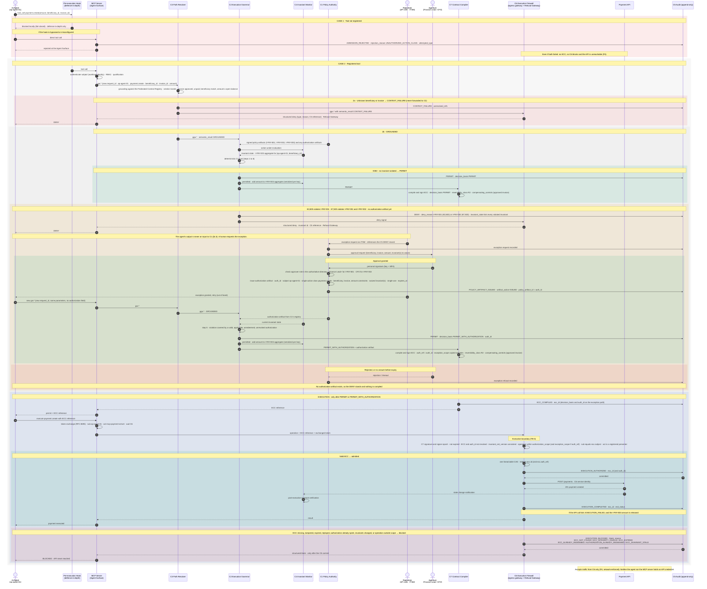

# Worked example — governed payment via MCP

> **Non-normative.** This example illustrates one way to realize the CROA logical architecture for a payment tool exposed over MCP. It adds no requirement. Where it differs from the specification, the specification governs. Invariant identifiers, thresholds, roles, the deployment split and the identity mechanism below are illustrative.
>
> **Vendor neutrality.** The example is technology-agnostic. It is compatible with an implementation that uses an agent runtime's own permission and hook mechanisms (for example, Claude Code hooks and permissions). That compatibility is not a certification by any vendor, and the hooks themselves provide no CROA guarantee. Conformance never requires any particular product (see [Vendor neutrality](../../README.md#vendor-neutrality)).

French version: [payment-via-mcp.fr.md](payment-via-mcp.fr.md).

## Scenario

An accounts-payable agent (`ap-agent-01`) can call the MCP tool `payment.create(amount, beneficiary_id, invoice_id)`. The payment API is a governed system behind the execution boundary.

The deployment is a **hybrid** (Part IV §18.3). The MCP server hosts the Agent Surface, as Part IV §23.5.2 suggests. `C6` runs at a separate egress gateway in front of the payment API, which is the DM-4 pattern (Part IV Chapter 22). In a pure DM-5 deployment `C6` would instead be embedded in the MCP server, and the MCP server would then hold the API credential.

The **pre-execution hook** in the agent runtime is **defense-in-depth only**. It catches unregistered tools early, but the guarantee does not come from it. The guarantee is `C6` together with P4: the payment API accepts traffic only from `C6`, and `C6` admits only operations derived from a valid, unredeemed ECC.

## Registered invariants (illustrative)

| Invariant | Class | Statement | Waivable by a `C1` authorization? |
|---|---|---|---|
| `I-PAY-001` | E1 | `payment.create` MUST NOT exceed €1,000 per payment without a `C1` authorization artifact covering the beneficiary, invoice and amount. | Yes, issued on a Finance Lead's (or higher) approval |
| `I-PAY-002` | E1 | `payment.create` MUST NOT exceed €5,000 per payment without a `C1` authorization artifact covering the beneficiary, invoice and amount. | Yes, issued on the CFO's approval |
| `I-PAY-003` | E2, TP-X | Cumulative `payment.create` value per (subject, `beneficiary_id`) over a rolling 24 h window MUST NOT exceed €10,000. | No: a cumulative breach is denied at `C2.eval` step 4, which has no authorization path (Part II §4.4.2) |

`I-PAY-003` is declared TP-X because a 24 h window spans sessions, and TP-X aggregates are keyed per subject (Part II §4.6.3). `C4` adds each permitted amount to the aggregate, serialized per key. In this example the amount is released again if the ECC is blocked, expires, or the execution fails.

**Reversibility.** A bank transfer is treated as **R2** (irreversible, low-impact) on every path. Every ECC therefore carries `ecc.reversibility_class = R2` and `ecc.compensating_controls`. In this example the R2 control is the prior human approval of the invoice in the ERP. `C3` verifies it at grounding: the invoice is approved and unpaid, its beneficiary matches, and the amount does not exceed the open balance. A Governed Exception is **not** recorded in `compensating_controls`; it is bound through `ecc.auth_ref` and `ecc.exception_scope`.

## The four paths

| Request | `C2.eval` outcome | Authorization | Result |
|---|---|---|---|
| €350 | `PERMIT` | none | ECC compiled and admitted |
| €3,500 | `DENY` (`I-PAY-001`), then `PERMIT_WITH_AUTHORIZATION` | Requested via ITSM; Finance Lead approves; `C1` issues `auth_id` waiving `I-PAY-001` | ECC with `auth_ref` and `exception_scope`; `ecc.id` and `auth_ref` redeemed in one CAS |
| €7,500 | `DENY` (`I-PAY-001`, `I-PAY-002`), then `PERMIT_WITH_AUTHORIZATION` | Same as above, with the CFO approving and both invariants waived | Same as above |
| Unregistered tool | none | none | Blocked by the hook. If the hook is bypassed: `ADMISSION_REJECTED` (`UNAUTHORIZED_ACTION_CLASS`) at the Agent Surface |

## Subject binding at the boundary

The MCP server presents the operation to `C6`, but the ECC subject is the agent. In this example the binding works like this:

1. The agent authenticates to the Agent Surface with a workload identity (for example, a SPIFFE SVID). That identity becomes `ecc.subject`.
2. To present, the MCP server performs an OAuth 2.0 token exchange (RFC 8693). The result is a short-lived token with `sub = ap-agent-01`, `act = mcp-payment-server` and audience `C6`, bound to the `ecc.id`.
3. `C6` checks that `sub` equals `ecc.subject` and that `act` is a registered presenter for this tool. An ECC presented under any other subject is blocked.

These checks are this example's own mechanism, not a §4.8 MUST. They implement the no-cross-subject-redemption clause of I8 (Part II §5.9, which cites Part IV §21.3). Neither the agent nor the MCP server holds a credential for the payment API; `C6` calls it with its own service identity. On identity and delegation, see Appendix O §O.5.

## Sequence

Solid arrows (`->>`) are synchronous. A `C5` write that must commit before the next step proceeds is shown with its acknowledgement.

## Spec references

- `C1` policy authority; agent output is never a `C1` input: Part II §4.3
- Authorization artifacts, `auth_ref` / `exception_scope` binding, single-use redemption: Part II §4.3.1
- Signer epoch and revocation status: Part II §4.3.3
- `C2.eval` steps and the `PERMIT` / `PERMIT_WITH_AUTHORIZATION` outcomes: Part II §4.4.2
- ECC compilation: Part II §4.4.3, §4.8, and `spec/schemas/ecc.schema.json`
- `CONTEXT_FAILURE` routed to `C6`, never to `C2`: Part II §4.5.1, §4.10
- `C4` session history and post-execution verification: Part II §4.6
- Trajectory profiles (TP-C, TP-X) and serialized aggregates: Part II §4.6.3
- Governance event fields: Part II §4.7.1 and `spec/schemas/event.schema.json`
- Atomic redemption, `AUTHORIZATION_ALREADY_REDEEMED`, Refusal Gateway: Part II §4.8
- Agent Surface, RBAC and qualification: Part II §4.9, §4.9.1
- Authorized inter-component flows: Part II §4.10
- No cross-subject redemption (I8): Part II §5.9
- Reversibility classes: Part I Chapter 3, Tenet T5; Part II §4.4.1 (`ecc.reversibility_class`, `ecc.compensating_controls`)
- Hybrid configurations: Part IV §18.3; DM-4 gateway: Part IV Chapter 22; MCP as Agent Surface host: Part IV §23.5.2
- Exception requests through ITSM / ChatOps: Part IV §24.4
- Agent identity and delegation: Appendix O §O.5
- Worked invariant pattern (`I-EC-001`): Appendix P §P.3.4
- Single-use exception test: Appendix Q, NT-007
