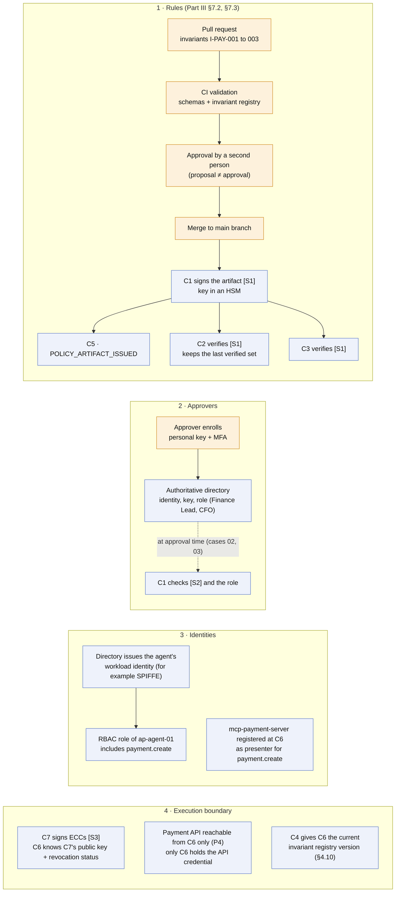
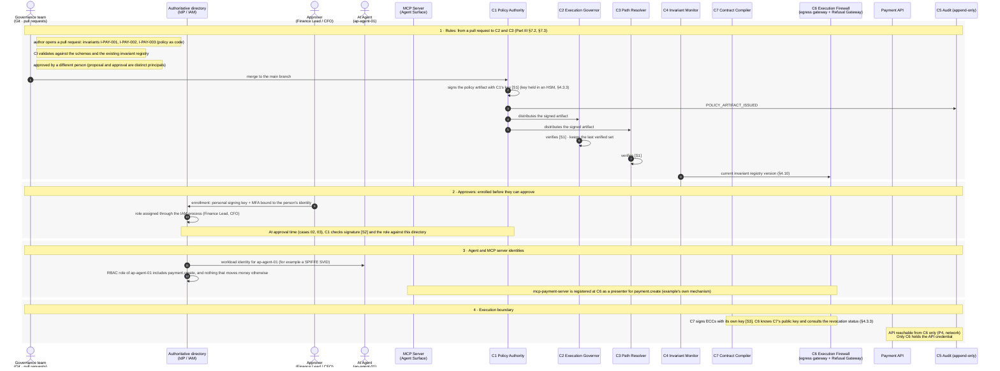

# 00 — Prerequisites

> **Non-normative.** Part of the [governed payment via MCP](README.md) worked example. The shared context (invariants, reversibility, deployment, subject binding, vendor-neutrality note and spec references) is in the [README](README.md).

Version française: [00-prerequisites](fr/00-prerequisites.md).

**Scope:** What must be in place before any request

Not a case: the state every case relies on. Four things are set up before the first request. The rules (`I-PAY-001` to `003`) go through a pull request, CI validation and approval by a second person, then `C1` signs them [S1] and distributes them to `C2` and `C3`. Approvers are enrolled in the authoritative directory with their personal key and role, which is what lets `C1` check their signature [S2] later. The agent receives its workload identity and its RBAC role, and the MCP server is registered as a presenter. Finally, `C7`'s key [S3] is known to `C6`, and only `C6` can reach the payment API (P4). Nothing here is numbered as a request step; the cases start numbering at the agent's call.

## Overview

## Sequence

[Index](README.md) · [Case 01 — €350, automatic →](01-auto-350.md)
