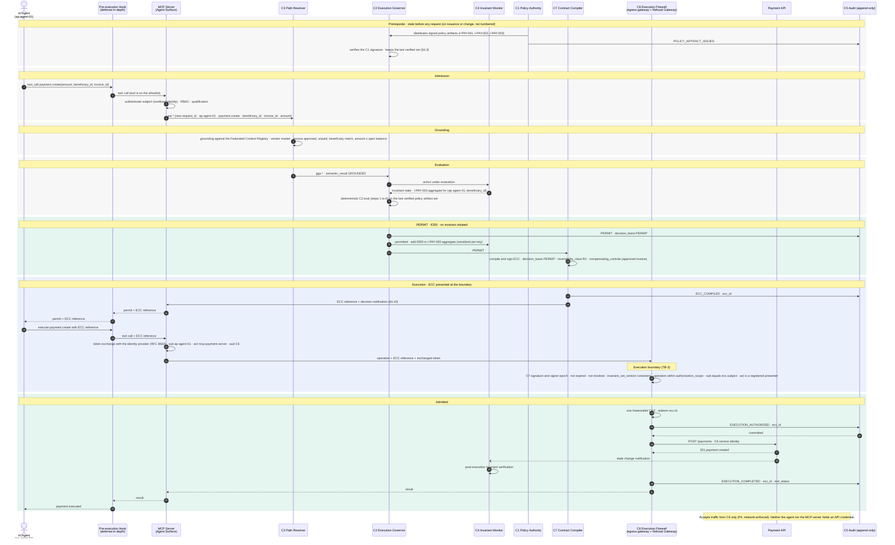

# Case 01 — €350, automatic

> **Non-normative.** Part of the [governed payment via MCP](README.md) worked example. The shared context (invariants, reversibility, deployment, subject binding, vendor-neutrality note and spec references) is in the [README](README.md).

Version française: [01-auto-350](fr/01-auto-350.md).

**Outcome:** €350 · `PERMIT` · executed

The baseline governed permit. No invariant is violated, so `C2` returns `PERMIT` and `C7` compiles an ECC with no exception fields. The ECC still carries `reversibility_class R2` and `compensating_controls`: a bank transfer is irreversible on every path. At the boundary `C6` redeems `ecc.id` in a single compare-and-swap, records `EXECUTION_AUTHORIZED` and waits for the commit before calling the API.

## Sequence

[Index](README.md) · [Case 02 — €3,500, Finance Lead exception →](02-exception-finance-3500.md)
