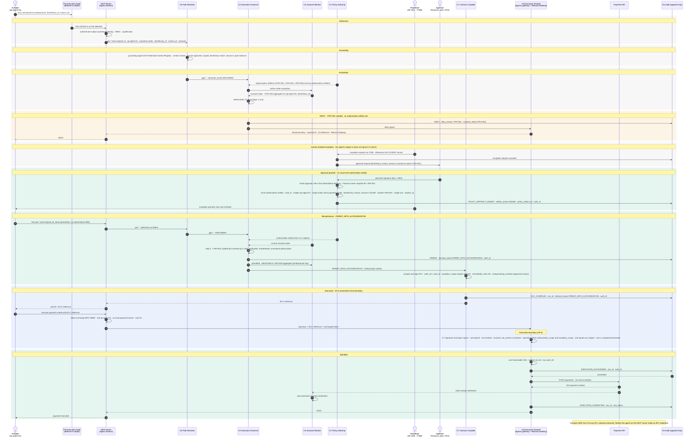

# Case 02 — €3,500, Finance Lead exception

> **Non-normative.** Part of the [governed payment via MCP](README.md) worked example. The shared context (invariants, reversibility, deployment, subject binding, vendor-neutrality note and spec references) is in the [README](README.md).

Version française: [02-exception-finance-3500](fr/02-exception-finance-3500.md).

**Outcome:** €3,500 · `DENY`, then `PERMIT_WITH_AUTHORIZATION` · executed

€3,500 violates `I-PAY-001`. `C2` denies through the Refusal Gateway. A human requester, never the agent, asks `C1` for an exception, a Finance Lead signs, and `C1` issues a single-use authorization artifact. The agent then submits a fresh request with no authorization field: `C2` finds the authorization in `C1`'s registry and returns `PERMIT_WITH_AUTHORIZATION`. `C7` binds `ecc.auth_ref` and `ecc.exception_scope`, and `C6` redeems `ecc.id` and `ecc.auth_ref` in the same compare-and-swap.

## Sequence

[← Case 01 — €350, automatic](01-auto-350.md) · [Index](README.md) · [Case 03 — €7,500, CFO exception →](03-exception-cfo-7500.md)
