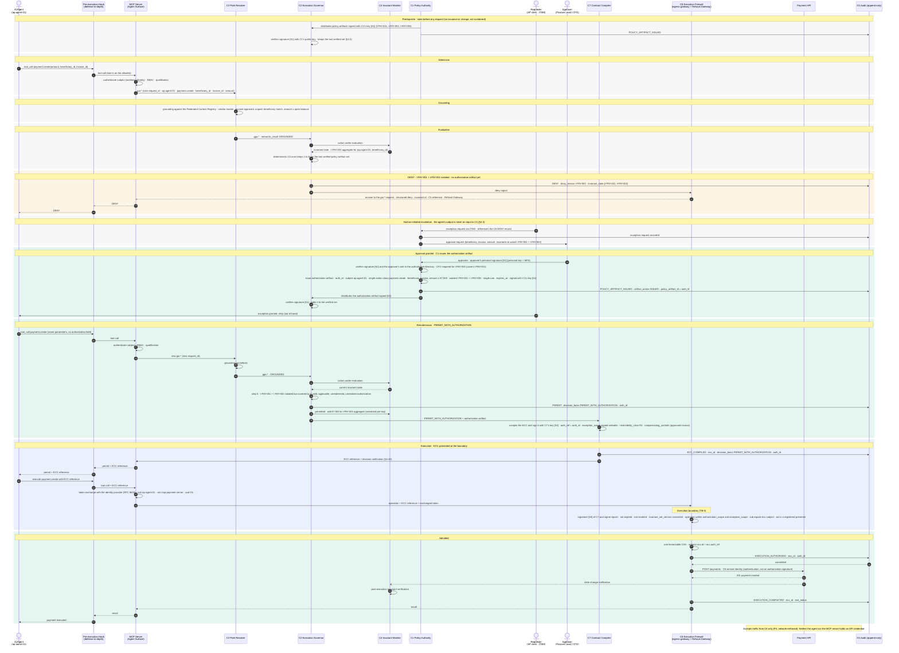

# Case 03 — €7,500, CFO exception

> **Non-normative.** Part of the [governed payment via MCP](README.md) worked example. The shared context (invariants, reversibility, deployment, subject binding, vendor-neutrality note and spec references) is in the [README](README.md).

Version française: [03-exception-cfo-7500](fr/03-exception-cfo-7500.md).

**Outcome:** €7,500 · `DENY`, then `PERMIT_WITH_AUTHORIZATION` · executed

Same flow as case 02, with two differences. €7,500 violates both `I-PAY-001` and `I-PAY-002`, so `deny_reason` names `I-PAY-002` and `invariant_state` lists both. Only the CFO can approve, and the authorization artifact waives both invariants. It is still one artifact, for one action, used once.

## Sequence

[← Case 02 — €3,500, Finance Lead exception](02-exception-finance-3500.md) · [Index](README.md) · [Case 04 — unregistered tool →](04-unregistered-tool.md)
