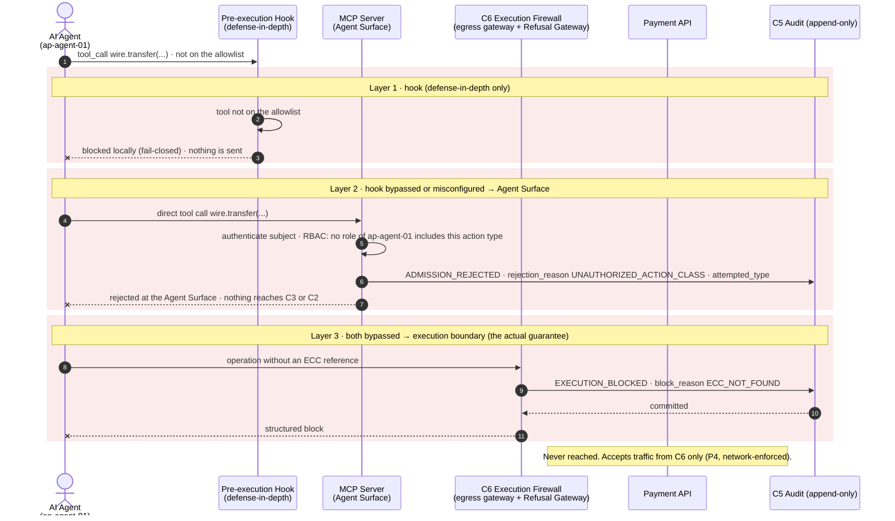

# Case 04 — unregistered tool

> **Non-normative.** Part of the [governed payment via MCP](README.md) worked example. The shared context (invariants, reversibility, deployment, subject binding, vendor-neutrality note and spec references) is in the [README](README.md).

Version française: [04-unregistered-tool](fr/04-unregistered-tool.md).

**Outcome:** Tool not registered · blocked at three layers

The agent calls a tool that is not registered (`wire.transfer`). The hook stops it first, but that is defense-in-depth only. If the hook is bypassed, the Agent Surface rejects the request with `ADMISSION_REJECTED` (`UNAUTHORIZED_ACTION_CLASS`). If both were bypassed, there would still be no ECC, so `C6` blocks and the API cannot be reached (P4). Access to a tool is not authority to execute.

## Sequence

[← Case 03 — €7,500, CFO exception](03-exception-cfo-7500.md) · [Index](README.md) · [Case 05 — context failure →](05-context-failure.md)
