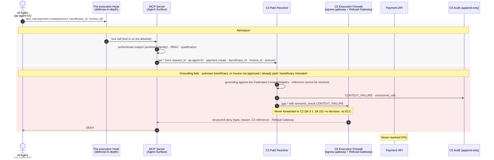

# Case 05 — context failure

> **Non-normative.** Part of the [governed payment via MCP](README.md) worked example. The shared context (invariants, reversibility, deployment, subject binding, vendor-neutrality note and spec references) is in the [README](README.md).

Version française: [05-context-failure](fr/05-context-failure.md).

**Outcome:** Unknown beneficiary or invoice · `CONTEXT_FAILURE` · refused

The request is admitted, but `C3` cannot ground it: the beneficiary is not in the vendor master, or the invoice is not approved, already paid, or for another beneficiary. A context failure is never forwarded to `C2` (§4.5.1, §4.10). `C3` records `CONTEXT_FAILURE` and hands the request to `C6`, whose Refusal Gateway returns a structured deny. No decision is made and no ECC exists.

## Sequence

[← Case 04 — unregistered tool](04-unregistered-tool.md) · [Index](README.md) · [Case 06 — exception refused →](06-exception-refused.md)
