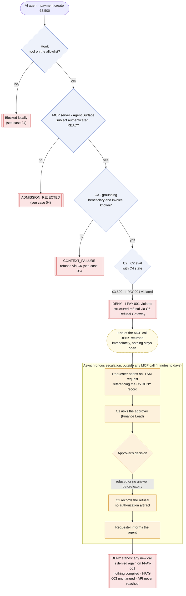
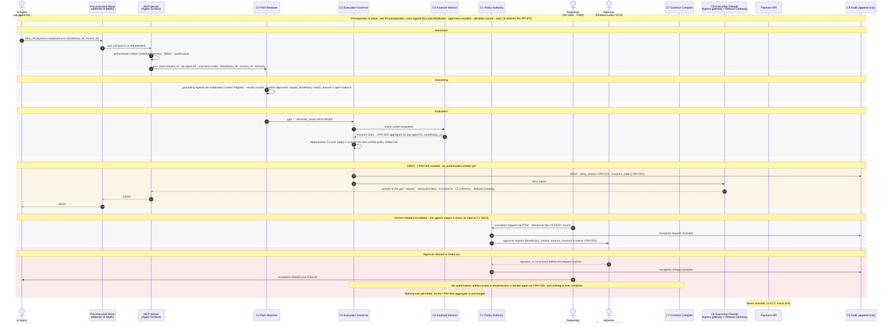

# Case 06 — exception refused

> **Non-normative.** Part of the [governed payment via MCP](README.md) worked example. The shared context (invariants, reversibility, deployment, subject binding, vendor-neutrality note and spec references) is in the [README](README.md).

Version française: [06-exception-refused](fr/06-exception-refused.md).

**Outcome:** €3,500 · `DENY` · approval refused or timed out · nothing executed

Starts like case 02, but the approver refuses, or does not answer before the request expires. `C1` issues no authorization artifact and records the refusal. The `DENY` stands: any resubmission is denied again on `I-PAY-001`, nothing is compiled, and the I-PAY-003 aggregate is unchanged.

## Overview

## Sequence

[← Case 05 — context failure](05-context-failure.md) · [Index](README.md) · [Case 07 — blocked at the execution boundary →](07-boundary-blocked.md)
