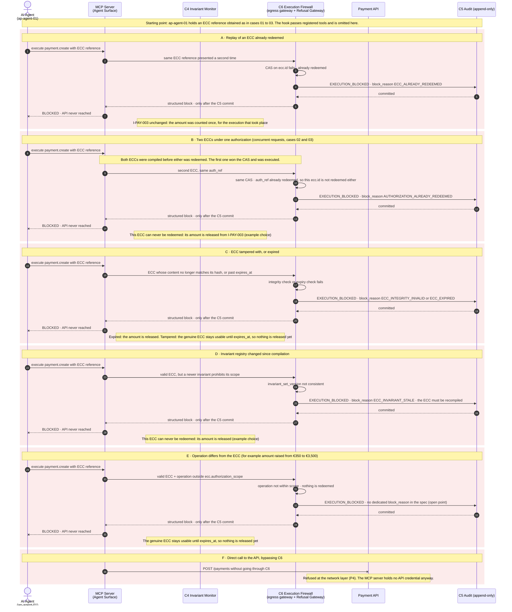

# Case 07 — blocked at the execution boundary

> **Non-normative.** Part of the [governed payment via MCP](README.md) worked example. The shared context (invariants, reversibility, deployment, subject binding, vendor-neutrality note and spec references) is in the [README](README.md).

Version française: [07-boundary-blocked](fr/07-boundary-blocked.md).

**Outcome:** ECC replayed, spent, tampered, expired, stale or exceeded · `EXECUTION_BLOCKED`

What happens when something reaches `C6` that does not match a valid, unredeemed ECC. Each variant is recorded as `EXECUTION_BLOCKED` with its `block_reason` and committed to `C5` before the block is returned. The API is never reached. Variant E has no dedicated `block_reason` in the current spec; that is an open point raised with the maintainers.

## Sequence

[← Case 06 — exception refused](06-exception-refused.md) · [Index](README.md)
