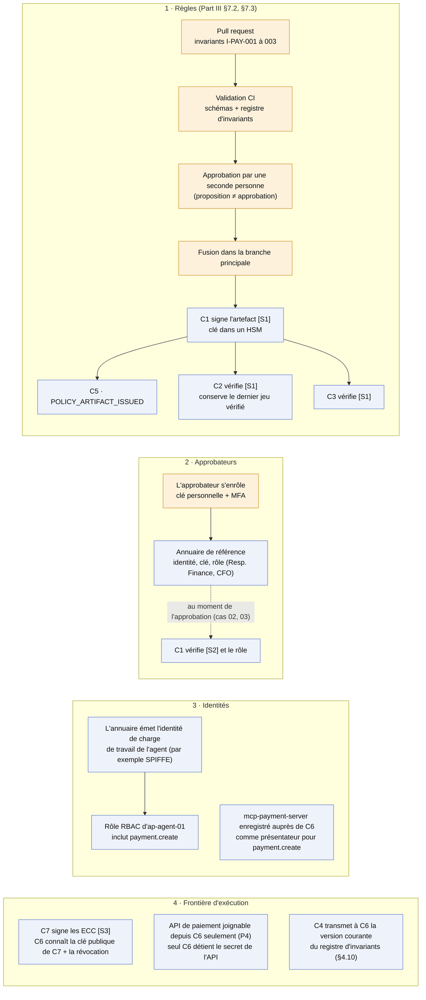
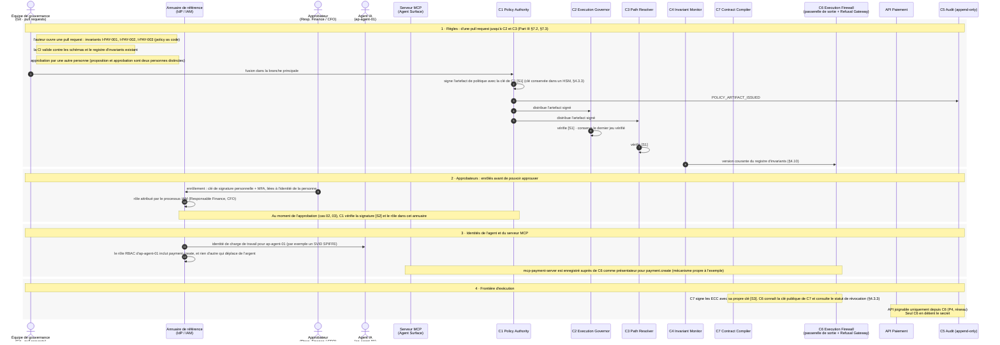

# 00 — Prérequis

> **Non normatif.** Fait partie de l'exemple commenté [paiement gouverné via MCP](README.md). Le contexte commun (invariants, réversibilité, déploiement, lien entre sujet et frontière, note de neutralité et références de la spec) est dans le [README](README.md).

English version: [00-prerequisites](../00-prerequisites.md).

**Portée:** Ce qui doit être en place avant toute demande

Ce n'est pas un cas : c'est l'état sur lequel reposent tous les cas. Quatre choses sont en place avant la première demande. Les règles (`I-PAY-001` à `003`) passent par une pull request, une validation en CI et l'approbation d'une seconde personne, puis `C1` les signe [S1] et les distribue à `C2` et `C3`. Les approbateurs sont enrôlés dans l'annuaire de référence avec leur clé personnelle et leur rôle : c'est ce qui permet ensuite à `C1` de vérifier leur signature [S2]. L'agent reçoit son identité de charge de travail et son rôle RBAC, et le serveur MCP est enregistré comme présentateur. Enfin, la clé de `C7` [S3] est connue de `C6`, et seul `C6` peut atteindre l'API de paiement (P4). Les étapes de ce fichier ne font pas partie d'une demande ; dans les cas, la numérotation commence à l'appel de l'agent.

## Vue d'ensemble

## Séquence

[Index](README.md) · [Cas 01 — 350 €, automatique →](01-auto-350.md)
