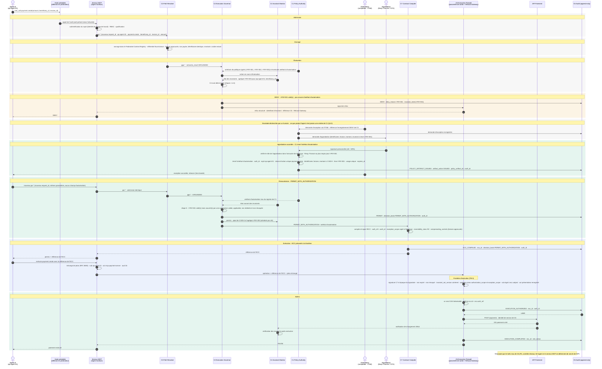

# Cas 02 — 3 500 €, exception Responsable Finance

> **Non normatif.** Fait partie de l'exemple commenté [paiement gouverné via MCP](README.md). Le contexte commun (invariants, réversibilité, déploiement, lien entre sujet et frontière, note de neutralité et références de la spec) est dans le [README](README.md).

English version: [02-exception-finance-3500](../02-exception-finance-3500.md).

**Résultat:** 3 500 € · `DENY`, puis `PERMIT_WITH_AUTHORIZATION` · exécuté

3 500 € viole `I-PAY-001`. `C2` refuse via la Refusal Gateway. Un demandeur humain, jamais l'agent, demande une exception à `C1`, un Responsable Finance signe, et `C1` émet un artefact d'autorisation à usage unique. L'agent soumet ensuite une nouvelle demande sans champ d'autorisation : `C2` trouve l'autorisation dans le registre de `C1` et rend `PERMIT_WITH_AUTHORIZATION`. `C7` lie `ecc.auth_ref` et `ecc.exception_scope`, et `C6` rédime `ecc.id` et `ecc.auth_ref` dans le même compare-and-swap.

## Séquence

[← Cas 01 — 350 €, automatique](01-auto-350.md) · [Index](README.md) · [Cas 03 — 7 500 €, exception CFO →](03-exception-cfo-7500.md)
