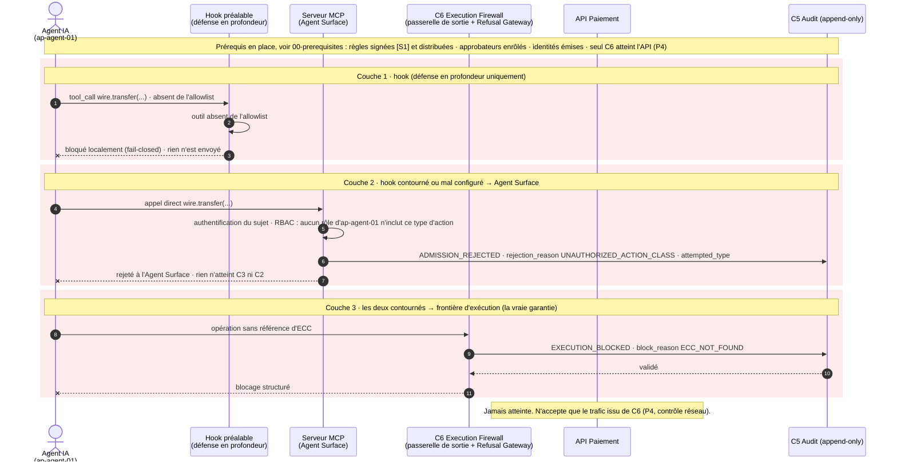

# Cas 04 — outil non enregistré

> **Non normatif.** Fait partie de l'exemple commenté [paiement gouverné via MCP](README.md). Le contexte commun (invariants, réversibilité, déploiement, lien entre sujet et frontière, note de neutralité et références de la spec) est dans le [README](README.md).

English version: [04-unregistered-tool](../04-unregistered-tool.md).

**Résultat:** Outil non enregistré · bloqué à trois niveaux

L'agent appelle un outil non enregistré (`wire.transfer`). Le hook l'arrête en premier, mais ce n'est qu'une défense en profondeur. Si le hook est contourné, l'Agent Surface rejette la demande avec `ADMISSION_REJECTED` (`UNAUTHORIZED_ACTION_CLASS`). Si les deux étaient contournés, il n'y aurait toujours pas d'ECC : `C6` bloque et l'API reste inaccessible (P4). L'accès à un outil ne vaut pas autorité d'exécution.

## Séquence

[← Cas 03 — 7 500 €, exception CFO](03-exception-cfo-7500.md) · [Index](README.md) · [Cas 05 — échec d'ancrage →](05-context-failure.md)
