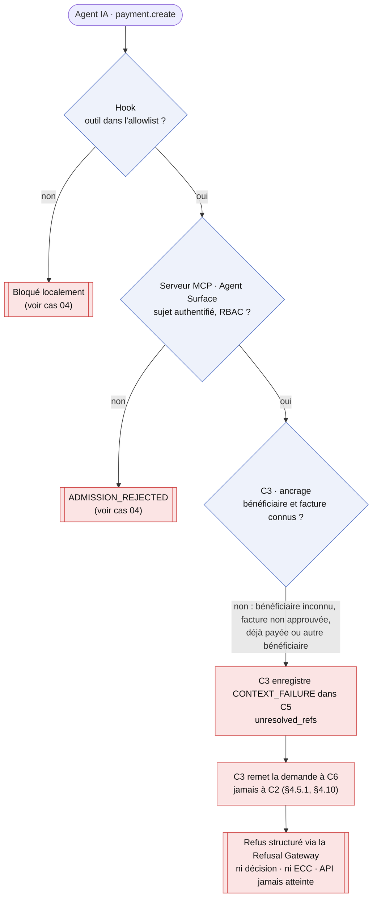
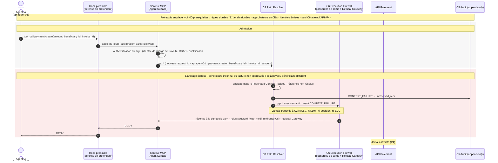

# Cas 05 — échec d'ancrage

> **Non normatif.** Fait partie de l'exemple commenté [paiement gouverné via MCP](README.md). Le contexte commun (invariants, réversibilité, déploiement, lien entre sujet et frontière, note de neutralité et références de la spec) est dans le [README](README.md).

English version: [05-context-failure](../05-context-failure.md).

**Résultat:** Bénéficiaire ou facture inconnus · `CONTEXT_FAILURE` · refusé

La demande est admise, mais `C3` ne peut pas l'ancrer : le bénéficiaire n'est pas dans le référentiel fournisseurs, ou la facture n'est pas approuvée, déjà payée, ou d'un autre bénéficiaire. Un échec d'ancrage n'est jamais transmis à `C2` (§4.5.1, §4.10). `C3` enregistre `CONTEXT_FAILURE` et remet la demande à `C6`, dont la Refusal Gateway renvoie un refus structuré. Aucune décision n'est prise et aucun ECC n'existe.

## Vue d'ensemble

## Séquence

[← Cas 04 — outil non enregistré](04-unregistered-tool.md) · [Index](README.md) · [Cas 06 — exception refusée →](06-exception-refused.md)
