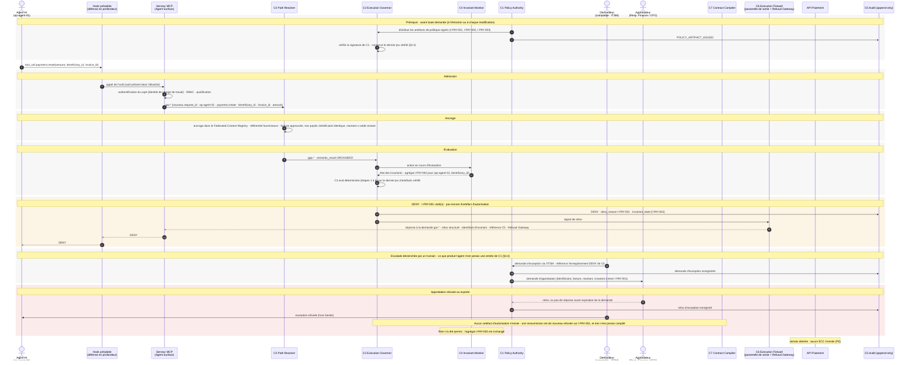

# Cas 06 — exception refusée

> **Non normatif.** Fait partie de l'exemple commenté [paiement gouverné via MCP](README.md). Le contexte commun (invariants, réversibilité, déploiement, lien entre sujet et frontière, note de neutralité et références de la spec) est dans le [README](README.md).

English version: [06-exception-refused](../06-exception-refused.md).

**Résultat:** 3 500 € · `DENY` · approbation refusée ou expirée · rien n'est exécuté

Commence comme le cas 02, mais l'approbateur refuse, ou ne répond pas avant l'expiration de la demande. `C1` n'émet aucun artefact d'autorisation et enregistre le refus. Le `DENY` tient : toute resoumission est de nouveau refusée sur `I-PAY-001`, rien n'est compilé, et l'agrégat I-PAY-003 reste inchangé.

## Séquence

[← Cas 05 — échec d'ancrage](05-context-failure.md) · [Index](README.md) · [Cas 07 — bloqué à la frontière d'exécution →](07-boundary-blocked.md)
