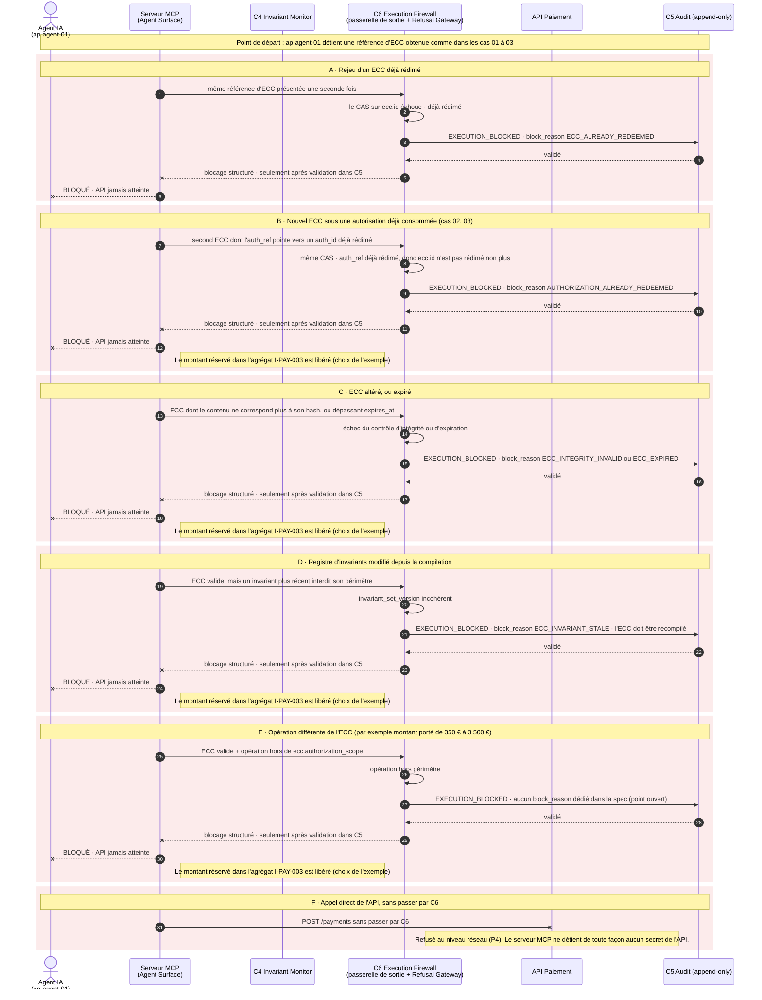

# Cas 07 — bloqué à la frontière d'exécution

> **Non normatif.** Fait partie de l'exemple commenté [paiement gouverné via MCP](README.md). Le contexte commun (invariants, réversibilité, déploiement, lien entre sujet et frontière, note de neutralité et références de la spec) est dans le [README](README.md).

English version: [07-boundary-blocked](../07-boundary-blocked.md).

**Résultat:** ECC rejoué, consommé, altéré, expiré, périmé ou dépassé · `EXECUTION_BLOCKED`

Ce qui se passe quand arrive à `C6` quelque chose qui ne correspond pas à un ECC valide et non rédimé. Chaque variante est enregistrée en `EXECUTION_BLOCKED` avec son `block_reason`, et validée dans `C5` avant que le blocage soit renvoyé. L'API n'est jamais atteinte. La variante E n'a pas de `block_reason` dédié dans la spec actuelle : c'est un point ouvert remonté aux mainteneurs.

## Séquence

[← Cas 06 — exception refusée](06-exception-refused.md) · [Index](README.md)
