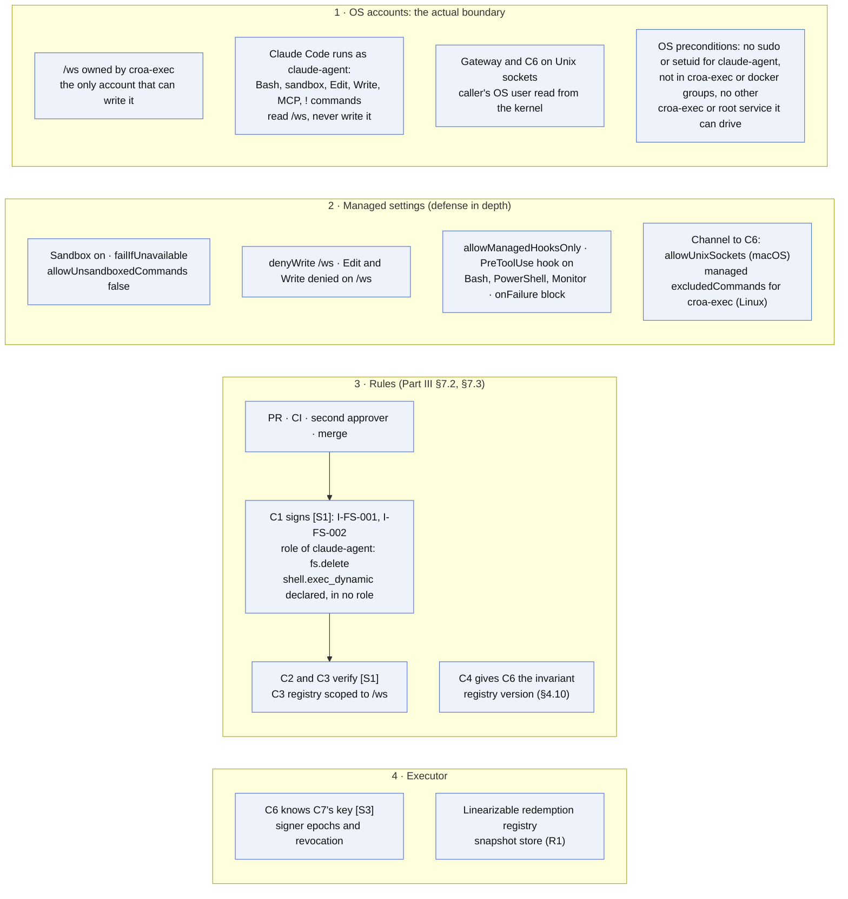
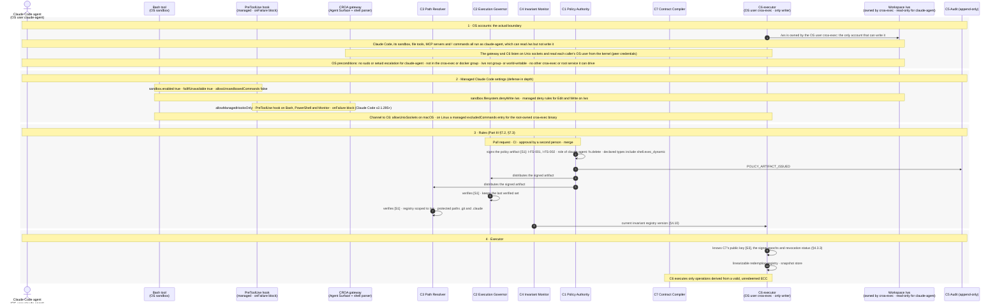

# 00 — Prerequisites

> **Non-normative.** Part of the [governed shell delete with Claude Code](README.md) worked example. The shared context (design, invariants, subject binding, limits, vendor-neutrality note and references) is in the [README](README.md).

Version française: [00-prerequisites](fr/00-prerequisites.md).

**Scope:** What must be in place before any command

Not a case: the state every case relies on. The boundary is the operating system's file ownership: the workspace `/ws` belongs to the OS user `croa-exec`, and Claude Code runs as `claude-agent`, which can read `/ws` but not write it. Everything Claude Code starts runs as `claude-agent`: its sandboxed shell, its file tools, MCP servers and `!` commands. This holds only under OS preconditions: `claude-agent` has no sudo or setuid escalation, is in neither the `croa-exec` group nor the docker group, and no service other than `C6` running as `croa-exec` or root can be driven by it. Managed Claude Code settings add defense in depth: the sandbox is on and the agent cannot retry outside it, `/ws` is also `denyWrite`, and only the organization's `PreToolUse` hook runs, blocking if it fails. The rules go through a pull request and a second approver before `C1` signs them [S1]. `C6` is the executor that runs as `croa-exec`: it verifies `C7`'s signature [S3], the revocation status and the invariant registry version before writing anything.

## Overview

## Sequence

[Index](README.md) · [Case 01 — rm of a workspace file →](01-rm-workspace-file.md)
