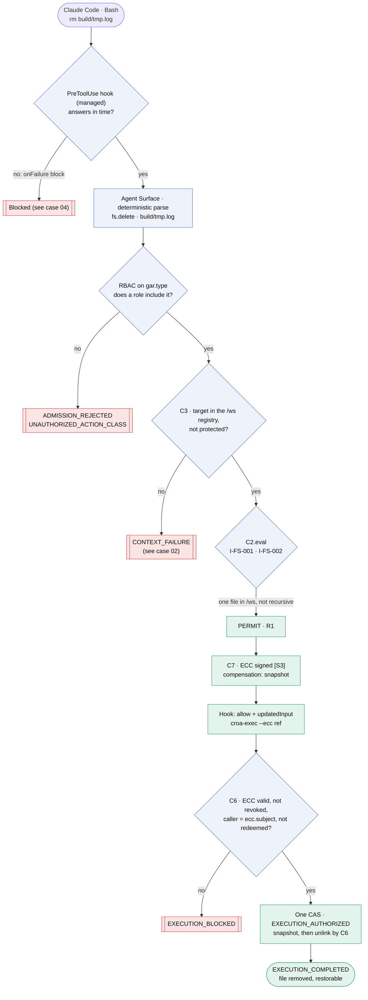
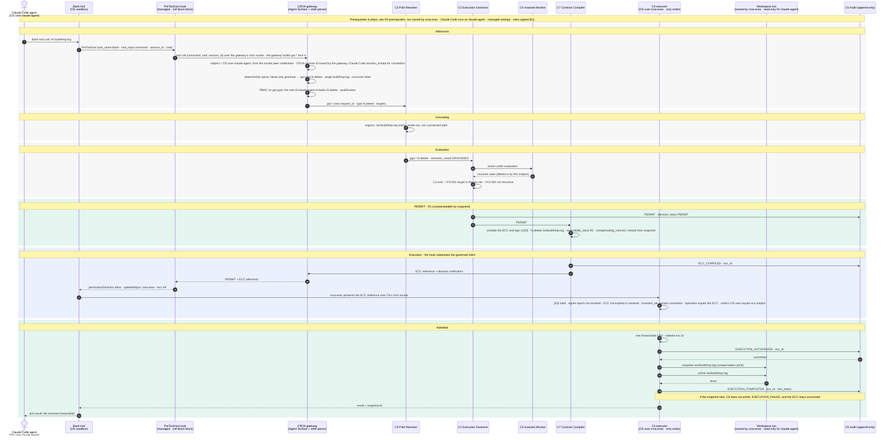

# Case 01 — rm of a workspace file

> **Non-normative.** Part of the [governed shell delete with Claude Code](README.md) worked example. The shared context (design, invariants, subject binding, limits, vendor-neutrality note and references) is in the [README](README.md).

Version française: [01-rm-workspace-file](fr/01-rm-workspace-file.md).

**Outcome:** `rm build/tmp.log` · `PERMIT` (R1) · executed by C6

The baseline. The Agent Surface parses the raw command with a deterministic, literal-only grammar and turns it into a `gar.*` of type `fs.delete`, so RBAC applies to the action, not to the `Bash` tool. `C3` grounds the target in the `/ws` registry and `C2` permits it. A snapshot is taken before the delete, so the transition is compensatable (R1), and the snapshot is the ECC's compensating control. On `PERMIT` the hook does not let the shell run `rm`. It returns `allow` with `updatedInput`, which replaces the command with `croa-exec`. `croa-exec` presents the ECC to `C6`, which checks it, redeems it and deletes the file as `croa-exec`.

## Overview

## Sequence

[← 00 — Prerequisites](00-prerequisites.md) · [Index](README.md) · [Case 02 — rm -rf /* →](02-rm-rf-root.md)
