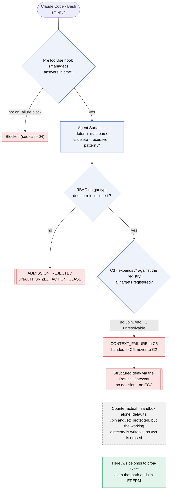
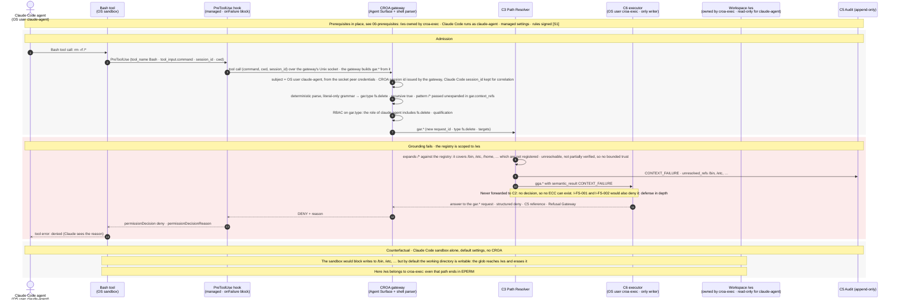

# Case 02 — rm -rf /*

> **Non-normative.** Part of the [governed shell delete with Claude Code](README.md) worked example. The shared context (design, invariants, subject binding, limits, vendor-neutrality note and references) is in the [README](README.md).

Version française: [02-rm-rf-root](fr/02-rm-rf-root.md).

**Outcome:** `rm -rf /*` · `CONTEXT_FAILURE` · refused, nothing deleted

The glob `/*` expands to `/bin`, `/etc`, `/home`, … and to `/ws` itself. This example scopes `C3`'s registry to `/ws`, so `/bin` and `/etc` are not registered entities: deleting them is outside the action surface by design (Part II §4.5.2, Part III §9.3). The references are unresolvable rather than partially verified, so `C3` records `CONTEXT_FAILURE` and hands the request to `C6`, which refuses it through the Refusal Gateway. The request never reaches `C2`, so no ECC can exist. Neither the hook's judgment nor a human stops it. The grey zone shows why the sandbox alone is not enough: with its default settings it protects `/bin` and `/etc`, but it leaves the working directory writable, so the same command would erase the workspace.

## Overview

## Sequence

[← Case 01 — rm of a workspace file](01-rm-workspace-file.md) · [Index](README.md) · [Case 03 — obfuscated delete →](03-obfuscated-delete.md)
