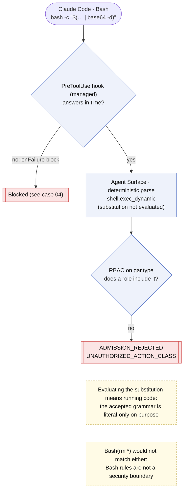
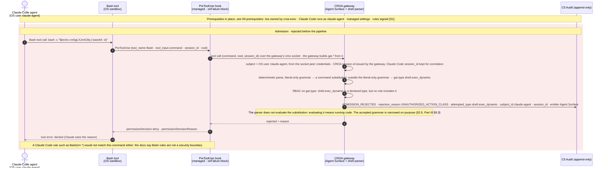

# Case 03 — obfuscated delete

> **Non-normative.** Part of the [governed shell delete with Claude Code](README.md) worked example. The shared context (design, invariants, subject binding, limits, vendor-neutrality note and references) is in the [README](README.md).

Version française: [03-obfuscated-delete](fr/03-obfuscated-delete.md).

**Outcome:** `bash -c "$(… | base64 -d)"` · `ADMISSION_REJECTED`

The same `rm -rf /*`, hidden in a base64 payload run by `bash -c`. The Agent Surface's parser accepts only a literal grammar: it does not evaluate a command substitution, because evaluating it means running code. The command therefore parses to `shell.exec_dynamic`, a type no role includes, and the request is rejected at admission with `UNAUTHORIZED_ACTION_CLASS`, before `C3` or `C2` see it. This is a deliberate narrowing of the action surface (Part I §2.6, Part III §9.3), not a guess about the payload. Claude Code's own rules would not help here: the docs state that a rule like `Bash(rm *)` does not match `bash -c '…'` and is not a security boundary.

## Overview

## Sequence

[← Case 02 — rm -rf /*](02-rm-rf-root.md) · [Index](README.md) · [Case 04 — attempts to bypass CROA →](04-raw-shell-bypass.md)
