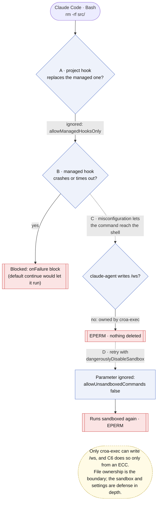
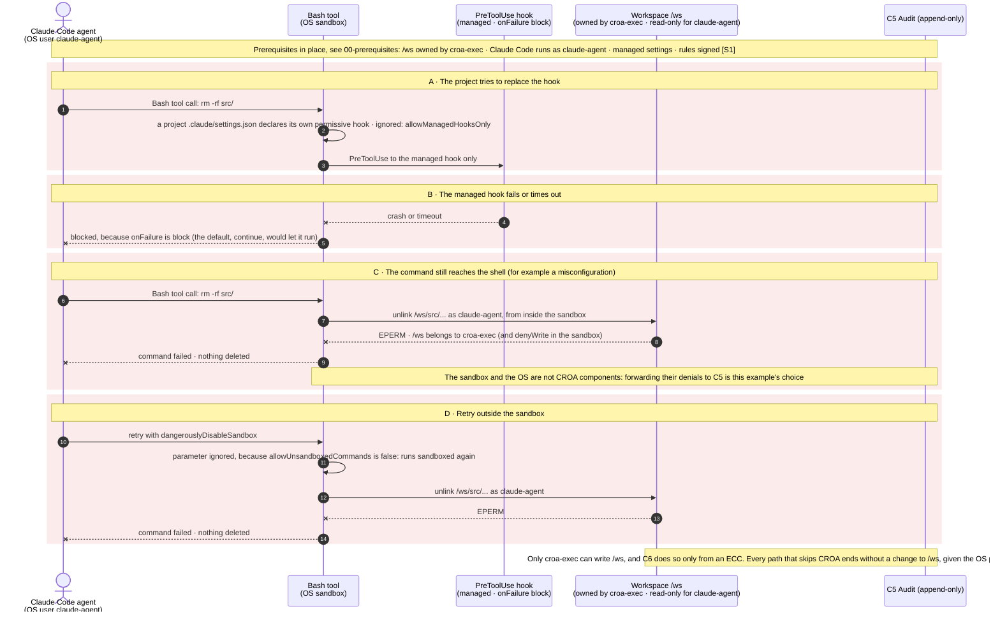

# Case 04 — attempts to bypass CROA

> **Non-normative.** Part of the [governed shell delete with Claude Code](README.md) worked example. The shared context (design, invariants, subject binding, limits, vendor-neutrality note and references) is in the [README](README.md).

Version française: [04-raw-shell-bypass](fr/04-raw-shell-bypass.md).

**Outcome:** Hook replaced, failing, or skipped · nothing deleted

What happens when a command tries to skip the governed path. A project cannot replace the managed hook (`allowManagedHooksOnly`). A crashing or slow hook blocks instead of letting the command through, because `onFailure` is `block`; the default, `continue`, would let it run. If a misconfiguration still lets the command reach the shell, it runs as `claude-agent`, which does not own `/ws`: the write fails with `EPERM`. A retry with `dangerouslyDisableSandbox` does not escape: with `allowUnsandboxedCommands: false`, Claude Code ignores the parameter and runs the command in the sandbox again. File ownership is what holds; the sandbox and the managed settings are defense in depth.

## Overview

## Sequence

[← Case 03 — obfuscated delete](03-obfuscated-delete.md) · [Index](README.md)
