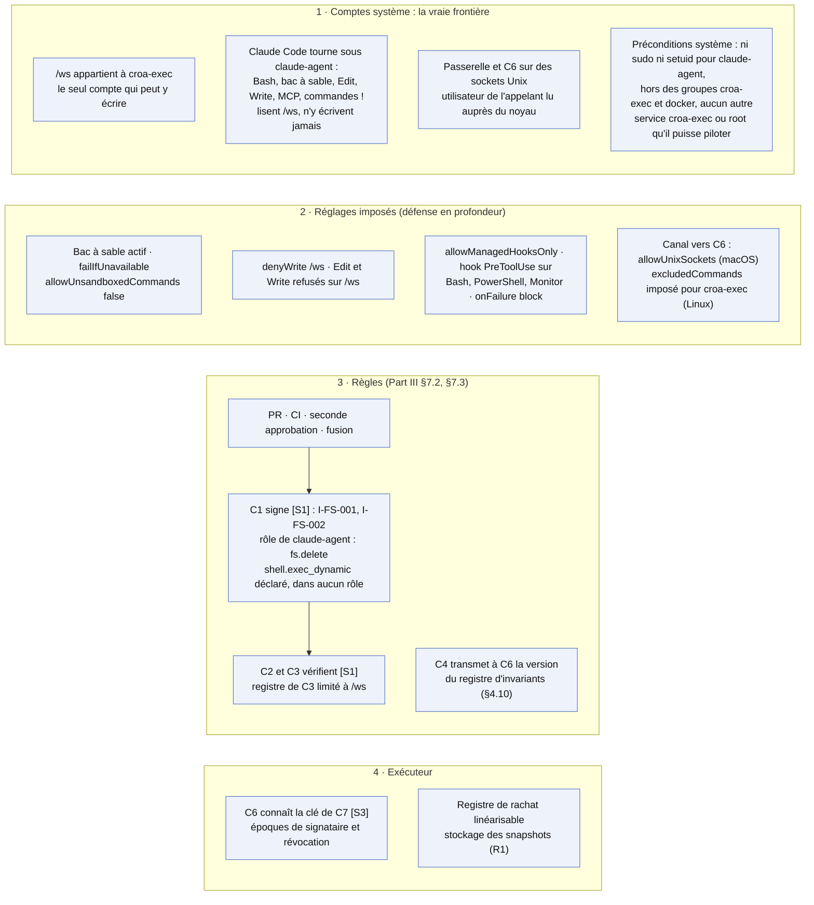

# 00 — Prérequis

> **Non normatif.** Fait partie de l'exemple commenté [suppression gouvernée dans le shell avec Claude Code](README.md). Le contexte commun (conception, invariants, identité du sujet, limites, note de neutralité et références) est dans le [README](README.md).

English version: [00-prerequisites](../00-prerequisites.md).

**Portée:** Ce qui doit être en place avant toute commande

Ce n'est pas un cas : c'est l'état sur lequel reposent tous les cas. La frontière, c'est la propriété des fichiers au niveau du système : le projet `/ws` appartient à l'utilisateur système `croa-exec`, et Claude Code tourne sous `claude-agent`, qui peut lire `/ws` mais pas y écrire. Tout ce que lance Claude Code tourne sous `claude-agent` : son shell dans le bac à sable, ses outils fichiers, les serveurs MCP et les commandes `!`. Cela ne tient que sous des préconditions système : `claude-agent` n'a ni sudo ni binaire setuid pour élever ses droits, n'est ni dans le groupe `croa-exec` ni dans le groupe docker, et aucun service autre que `C6` tournant sous `croa-exec` ou root ne peut être piloté par lui. Les réglages imposés de Claude Code ajoutent une défense en profondeur : le bac à sable est actif et l'agent ne peut pas relancer hors de lui, `/ws` est aussi en `denyWrite`, et seul le hook `PreToolUse` de l'organisation s'exécute, en bloquant s'il échoue. Les règles passent par une pull request et une seconde approbation avant que `C1` les signe [S1]. `C6` est l'exécuteur qui tourne sous `croa-exec` : il vérifie la signature de `C7` [S3], le statut de révocation et la version du registre d'invariants avant d'écrire quoi que ce soit.

## Vue d'ensemble

## Séquence

```mermaid
sequenceDiagram
    autonumber
    actor AG as Agent Claude Code<br/>(utilisateur système claude-agent)
    participant CC as Outil Bash<br/>(bac à sable OS)
    participant HK as Hook PreToolUse<br/>(imposé · onFailure block)
    participant SRV as Passerelle CROA<br/>(Agent Surface + analyseur shell)
    participant C3 as C3 Path Resolver
    participant C2 as C2 Execution Governor
    participant C4 as C4 Invariant Monitor
    participant C1 as C1 Policy Authority
    participant C7 as C7 Contract Compiler
    participant C6 as Exécuteur C6<br/>(utilisateur croa-exec · seul à écrire)
    participant FS as Projet /ws<br/>(propriété de croa-exec · lecture seule pour claude-agent)
    participant C5 as C5 Audit (append-only)

    rect rgba(120, 120, 120, 0.06)
        Note over AG,C5: 1 · Comptes système : la vraie frontière
        C6->>FS: /ws appartient à l'utilisateur système croa-exec : le seul compte qui peut y écrire
        Note over AG,FS: Claude Code, son bac à sable, ses outils fichiers, les serveurs MCP et les commandes ! tournent tous sous claude-agent, qui peut lire /ws mais pas y écrire
        Note over SRV,C6: La passerelle et C6 écoutent sur des sockets Unix et lisent l'utilisateur système de chaque appelant auprès du noyau (identifiants du pair)
        Note over AG,FS: Préconditions système : ni sudo ni setuid pour claude-agent · ni dans le groupe croa-exec ni dans le groupe docker · /ws non inscriptible par le groupe ou par tous · aucun autre service croa-exec ou root qu'il puisse piloter
    end
    rect rgba(120, 120, 120, 0.06)
        Note over AG,C5: 2 · Réglages Claude Code imposés (défense en profondeur)
        Note over CC,HK: sandbox.enabled true · failIfUnavailable true · allowUnsandboxedCommands false
        Note over CC,FS: sandbox.filesystem.denyWrite /ws · règles de refus imposées pour Edit et Write sur /ws
        Note over HK,SRV: allowManagedHooksOnly · hook PreToolUse sur Bash, PowerShell et Monitor · onFailure block (Claude Code v2.1.295+)
        Note over CC,C6: Canal vers C6 : allowUnixSockets sur macOS · sur Linux, une entrée excludedCommands imposée pour le binaire croa-exec, propriété de root
    end
    rect rgba(120, 120, 120, 0.06)
        Note over AG,C5: 3 · Règles (Part III §7.2, §7.3)
        Note over C1,C2: Pull request · CI · approbation par une seconde personne · fusion
        C1->>C1: signe l'artefact de politique [S1] : I-FS-001, I-FS-002 · rôle de claude-agent : fs.delete · types déclarés : dont shell.exec_dynamic
        C1->>C5: POLICY_ARTIFACT_ISSUED
        C1->>C2: distribue l'artefact signé
        C1->>C3: distribue l'artefact signé
        C2->>C2: vérifie [S1] · conserve le dernier jeu vérifié
        C3->>C3: vérifie [S1] · registre limité à /ws · chemins protégés .git et .claude
        C4->>C6: version courante du registre d'invariants (§4.10)
    end
    rect rgba(120, 120, 120, 0.06)
        Note over AG,C5: 4 · Exécuteur
        C6->>C6: connaît la clé publique de C7 [S3], les époques de signataire et le statut de révocation (§4.3.3)
        C6->>C6: registre de rachat linéarisable · stockage des snapshots
        Note over C7,C6: C6 n'exécute que des opérations issues d'un ECC valide et non rédimé
    end
```

[Index](README.md) · [Cas 01 — rm d'un fichier du projet →](01-rm-workspace-file.md)
