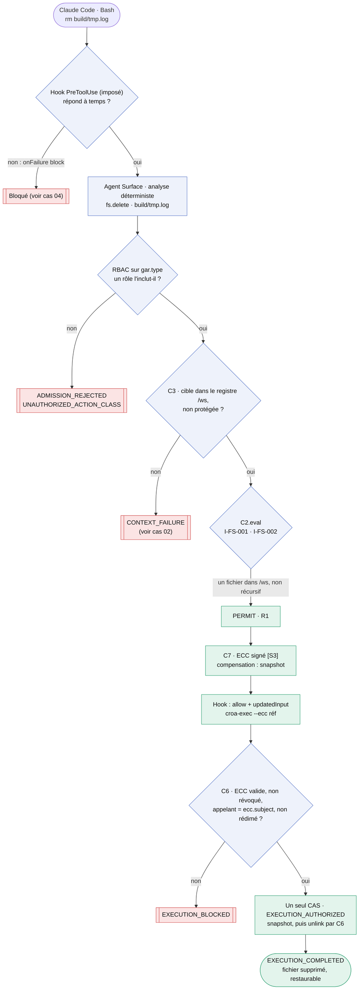
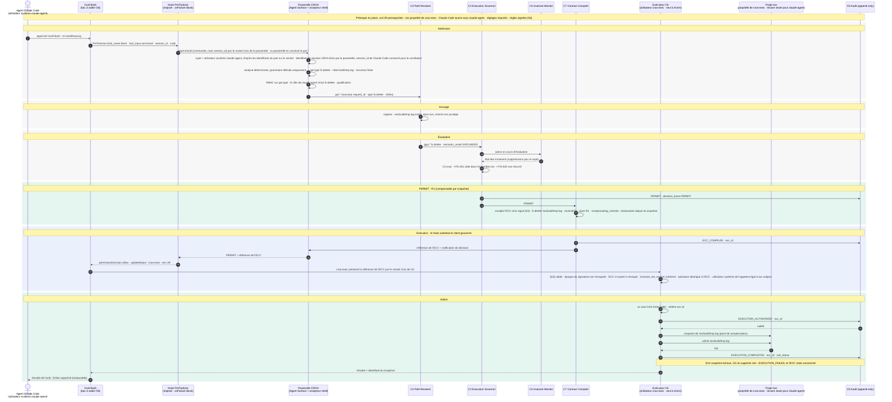

# Cas 01 — rm d'un fichier du projet

> **Non normatif.** Fait partie de l'exemple commenté [suppression gouvernée dans le shell avec Claude Code](README.md). Le contexte commun (conception, invariants, identité du sujet, limites, note de neutralité et références) est dans le [README](README.md).

English version: [01-rm-workspace-file](../01-rm-workspace-file.md).

**Résultat:** `rm build/tmp.log` · `PERMIT` (R1) · exécuté par C6

Le cas de base. L'Agent Surface analyse la commande brute avec une grammaire déterministe, limitée aux arguments littéraux, et la transforme en `gar.*` de type `fs.delete` : le RBAC porte donc sur l'action, pas sur l'outil `Bash`. `C3` ancre la cible dans le registre de `/ws` et `C2` la permet. Un snapshot est pris avant la suppression : la transition est compensable (R1), et le snapshot est le contrôle compensatoire de l'ECC. Sur `PERMIT`, le hook ne laisse pas le shell exécuter `rm`. Il répond `allow` avec `updatedInput`, qui remplace la commande par `croa-exec`. `croa-exec` présente l'ECC à `C6`, qui le vérifie, le rédime et supprime le fichier sous `croa-exec`.

## Vue d'ensemble

## Séquence

[← 00 — Prérequis](00-prerequisites.md) · [Index](README.md) · [Cas 02 — rm -rf /* →](02-rm-rf-root.md)
