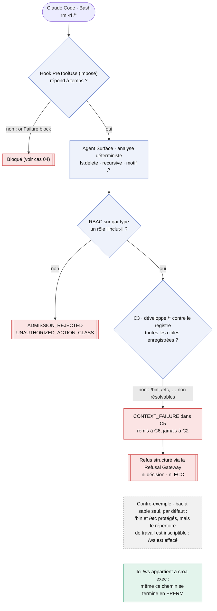
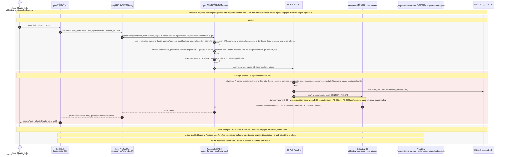

# Cas 02 — rm -rf /*

> **Non normatif.** Fait partie de l'exemple commenté [suppression gouvernée dans le shell avec Claude Code](README.md). Le contexte commun (conception, invariants, identité du sujet, limites, note de neutralité et références) est dans le [README](README.md).

English version: [02-rm-rf-root](../02-rm-rf-root.md).

**Résultat:** `rm -rf /*` · `CONTEXT_FAILURE` · refusé, rien n'est supprimé

Le glob `/*` s'étend à `/bin`, `/etc`, `/home`, … et à `/ws` lui-même. Cet exemple limite le registre de `C3` à `/ws` : `/bin` et `/etc` ne sont pas des entités enregistrées, et les supprimer est hors de la surface d'action par conception (Part II §4.5.2, Part III §9.3). Les références sont non résolvables, pas partiellement vérifiées : `C3` enregistre `CONTEXT_FAILURE` et remet la demande à `C6`, qui la refuse via la Refusal Gateway. La demande n'atteint jamais `C2`, donc aucun ECC ne peut exister. Ce n'est ni le jugement du hook ni un humain qui l'arrête. La zone grise montre pourquoi le bac à sable seul ne suffit pas : avec ses réglages par défaut, il protège `/bin` et `/etc`, mais laisse le répertoire de travail inscriptible, et la même commande effacerait le projet.

## Vue d'ensemble

## Séquence

[← Cas 01 — rm d'un fichier du projet](01-rm-workspace-file.md) · [Index](README.md) · [Cas 03 — suppression déguisée →](03-obfuscated-delete.md)
