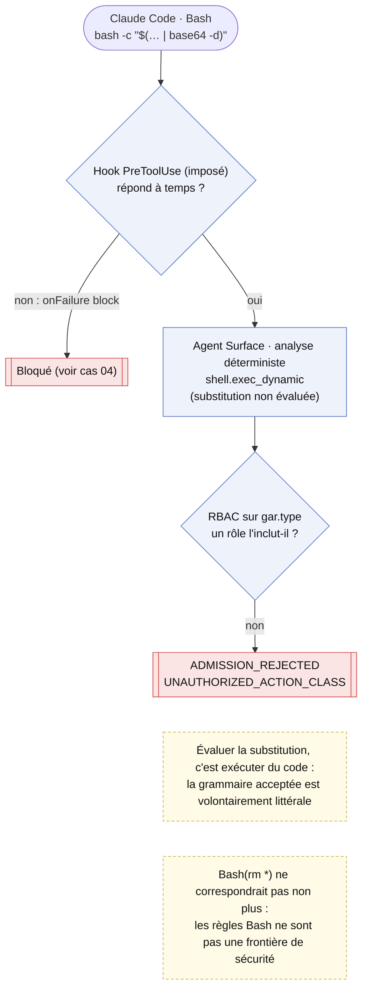
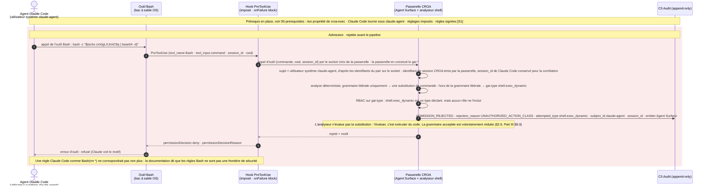

# Cas 03 — suppression déguisée

> **Non normatif.** Fait partie de l'exemple commenté [suppression gouvernée dans le shell avec Claude Code](README.md). Le contexte commun (conception, invariants, identité du sujet, limites, note de neutralité et références) est dans le [README](README.md).

English version: [03-obfuscated-delete](../03-obfuscated-delete.md).

**Résultat:** `bash -c "$(… | base64 -d)"` · `ADMISSION_REJECTED`

Le même `rm -rf /*`, caché dans un contenu base64 exécuté par `bash -c`. L'analyseur de l'Agent Surface n'accepte qu'une grammaire littérale : il n'évalue pas une substitution de commande, parce que l'évaluer, c'est exécuter du code. La commande donne donc `shell.exec_dynamic`, un type qu'aucun rôle n'inclut, et la demande est rejetée à l'admission avec `UNAUTHORIZED_ACTION_CLASS`, avant que `C3` ou `C2` ne la voient. C'est une réduction volontaire de la surface d'action (Part I §2.6, Part III §9.3), pas une supposition sur le contenu. Les règles de Claude Code n'aideraient pas : la documentation précise qu'une règle comme `Bash(rm *)` ne correspond pas à `bash -c '…'` et n'est pas une frontière de sécurité.

## Vue d'ensemble

## Séquence

[← Cas 02 — rm -rf /*](02-rm-rf-root.md) · [Index](README.md) · [Cas 04 — tentatives de contournement →](04-raw-shell-bypass.md)
