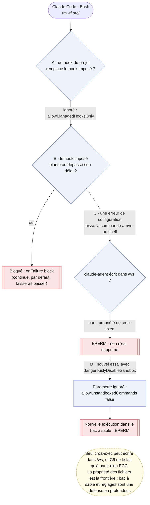
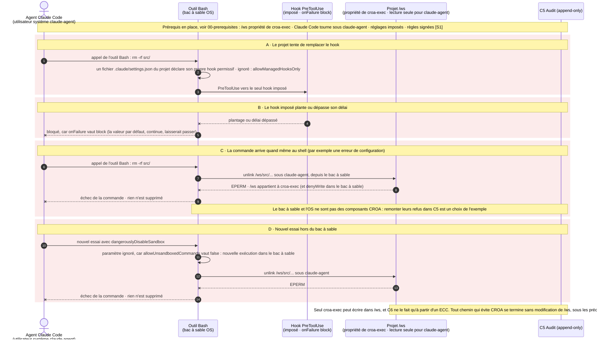

# Cas 04 — tentatives de contournement

> **Non normatif.** Fait partie de l'exemple commenté [suppression gouvernée dans le shell avec Claude Code](README.md). Le contexte commun (conception, invariants, identité du sujet, limites, note de neutralité et références) est dans le [README](README.md).

English version: [04-raw-shell-bypass](../04-raw-shell-bypass.md).

**Résultat:** Hook remplacé, en échec ou évité · rien n'est supprimé

Ce qui se passe quand une commande tente d'éviter le chemin gouverné. Un projet ne peut pas remplacer le hook imposé (`allowManagedHooksOnly`). Un hook qui plante ou tarde bloque au lieu de laisser passer, car `onFailure` vaut `block` ; la valeur par défaut, `continue`, laisserait passer. Si une erreur de configuration laisse quand même la commande arriver au shell, elle tourne sous `claude-agent`, qui n'est pas propriétaire de `/ws` : l'écriture échoue avec `EPERM`. Un nouvel essai avec `dangerouslyDisableSandbox` ne permet pas de s'échapper : avec `allowUnsandboxedCommands: false`, Claude Code ignore le paramètre et relance la commande dans le bac à sable. C'est la propriété des fichiers qui tient ; le bac à sable et les réglages imposés sont une défense en profondeur.

## Vue d'ensemble

## Séquence

[← Cas 03 — suppression déguisée](03-obfuscated-delete.md) · [Index](README.md)
